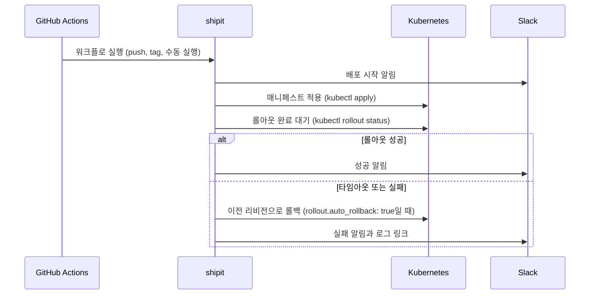

# shipit

shipit은 GitHub Actions 워크플로에서 쿠버네티스 클러스터로 애플리케이션을 배포하고, 배포 시작·성공·실패를 슬랙 채널에 알리는 사내 배포 도구입니다. 저장소에 설정 파일 `.shipit.yml` 하나와 워크플로 스텝 하나를 추가해서 씁니다.

## 배포 흐름



## 사전 준비

| 항목 | 내용 |
| --- | --- |
| 클러스터 접근 권한 | 배포 대상 네임스페이스에 `apply`, `rollout` 권한이 있는 서비스 계정의 kubeconfig |
| 슬랙 웹훅 | 알림을 받을 채널의 Incoming Webhook URL |
| 컨테이너 이미지 | 워크플로 앞 단계에서 빌드하고 레지스트리에 푸시한 이미지 |

kubeconfig와 웹훅 URL은 저장소의 **Settings → Secrets and variables → Actions**에 아래 이름으로 등록합니다.

| 시크릿 이름 | 값 |
| --- | --- |
| `SHIPIT_KUBECONFIG` | base64로 인코딩한 kubeconfig (`base64 -w0 kubeconfig.yaml`) |
| `SHIPIT_SLACK_WEBHOOK` | 슬랙 Incoming Webhook URL |

## 설치

### 1. 설정 파일 추가

저장소 루트에 `.shipit.yml`을 만듭니다.

```yaml
app: payment-api
cluster: prod-apne2          # 사내 클러스터 이름
namespace: payment

manifests:
  - k8s/deployment.yaml
  - k8s/service.yaml

image:
  name: registry.example.com/payment/payment-api
  # 매니페스트 안의 이 문자열을 실제 이미지 태그로 바꿉니다
  placeholder: IMAGE_TAG

rollout:
  deployments:
    - payment-api
  timeout: 300s
  auto_rollback: true

slack:
  channel: "#deploy-payment"
  mention_on_failure: "@payment-oncall"
```

### 2. 워크플로에 스텝 추가

`.github/workflows/deploy.yml`에 shipit 스텝을 넣습니다. 이미지 빌드·푸시 스텝 다음에 둡니다.

```yaml
name: deploy

on:
  push:
    branches: [main]
  workflow_dispatch:

jobs:
  deploy:
    runs-on: ubuntu-latest
    steps:
      - uses: actions/checkout@v4

      # 이미지 빌드·푸시 스텝 생략

      - name: Deploy with shipit
        uses: our-org/shipit@v1
        with:
          config: .shipit.yml
          image-tag: ${{ github.sha }}
          kubeconfig: ${{ secrets.SHIPIT_KUBECONFIG }}
          slack-webhook: ${{ secrets.SHIPIT_SLACK_WEBHOOK }}
```

`main`에 푸시하면 배포가 시작되고, Actions 탭의 **Run workflow** 버튼으로 수동 실행할 수도 있습니다.

## 설정 항목

### `.shipit.yml`

| 키 | 필수 | 기본값 | 설명 |
| --- | --- | --- | --- |
| `app` | 예 | — | 슬랙 알림에 표시할 앱 이름 |
| `cluster` | 예 | — | 배포 대상 클러스터 이름. kubeconfig의 context 이름과 같아야 함 |
| `namespace` | 예 | — | 배포 대상 네임스페이스 |
| `manifests` | 예 | — | 적용할 매니페스트 파일 경로 목록. 적힌 순서대로 적용 |
| `image.name` | 예 | — | 레지스트리를 포함한 이미지 이름 |
| `image.placeholder` | 아니요 | `IMAGE_TAG` | 매니페스트에서 이미지 태그로 치환할 문자열 |
| `rollout.deployments` | 아니요 | 전체 Deployment | 롤아웃 완료를 기다릴 Deployment 이름 목록 |
| `rollout.timeout` | 아니요 | `300s` | 롤아웃 대기 시간. 넘기면 실패로 처리 |
| `rollout.auto_rollback` | 아니요 | `true` | 실패 시 `kubectl rollout undo`로 이전 리비전 복구 |
| `slack.channel` | 아니요 | 웹훅 기본 채널 | 알림을 보낼 채널 |
| `slack.mention_on_failure` | 아니요 | 없음 | 실패 알림에 붙일 멘션 (사용자 또는 그룹) |

### 액션 입력값

| 입력 | 필수 | 설명 |
| --- | --- | --- |
| `config` | 아니요 | 설정 파일 경로. 기본값 `.shipit.yml` |
| `image-tag` | 예 | 배포할 이미지 태그 |
| `kubeconfig` | 예 | base64로 인코딩한 kubeconfig |
| `slack-webhook` | 아니요 | 슬랙 웹훅 URL. 비워 두면 알림을 보내지 않음 |
| `dry-run` | 아니요 | `true`면 `kubectl apply --dry-run=server`만 실행하고 슬랙 알림을 보내지 않음 |

## 슬랙 알림

알림은 배포 한 건당 시작 메시지 하나로 올라가고, 결과는 같은 메시지의 스레드에 답글로 붙습니다. 메시지에는 다음 정보가 들어갑니다.

- 앱 이름, 클러스터, 네임스페이스
- 이미지 태그와 커밋 링크
- 배포를 실행한 GitHub 사용자
- 워크플로 실행 로그 링크
- 실패 시 실패한 단계, 롤백 여부, `mention_on_failure` 멘션

## 롤백

`auto_rollback: true`이면 롤아웃이 `timeout` 안에 끝나지 않거나 실패할 때 shipit이 `rollout.deployments`에 적힌 Deployment를 이전 리비전으로 되돌립니다. 자동 롤백은 Deployment만 되돌리며, 같은 배포에서 바뀐 ConfigMap, Secret, Service는 그대로 남습니다.

특정 버전으로 직접 되돌리려면 이전 커밋의 SHA를 `image-tag`로 넘겨 워크플로를 수동 실행합니다.

## 배포 전 매니페스트 검증

배포 전에 치환 결과와 서버 측 검증만 확인하려면 `dry-run`을 켭니다.

```yaml
      - name: Validate manifests
        uses: our-org/shipit@v1
        with:
          image-tag: ${{ github.sha }}
          kubeconfig: ${{ secrets.SHIPIT_KUBECONFIG }}
          dry-run: true
```

PR 워크플로에 이 스텝을 넣으면 머지 전에 매니페스트 오류를 확인할 수 있습니다.

## 문제 해결

| 증상 | 원인 | 조치 |
| --- | --- | --- |
| `context "prod-apne2" not found` | `cluster` 값과 kubeconfig의 context 이름이 다름 | `kubectl config get-contexts`로 이름을 확인하고 `.shipit.yml` 수정 |
| `forbidden: User ... cannot patch resource` | 서비스 계정에 네임스페이스 권한 없음 | 플랫폼팀에 RoleBinding 추가 요청 |
| `rollout status timed out` | 파드가 Ready 상태가 되지 않음 | `kubectl describe pod`로 이벤트 확인. 이미지 풀 실패, 프로브 실패가 흔한 원인 |
| 슬랙 알림이 오지 않음 | 웹훅 URL 만료 또는 채널에서 앱 제거 | 웹훅을 다시 발급해 `SHIPIT_SLACK_WEBHOOK` 갱신 |
| 매니페스트에 `IMAGE_TAG`가 그대로 남음 | `image.placeholder`와 매니페스트 문자열 불일치 | 대소문자까지 같은지 확인 |

## 지원하지 않는 것

- Helm 차트, Kustomize 오버레이: shipit은 평문 YAML 매니페스트만 적용합니다. Helm이나 Kustomize를 쓰는 저장소는 렌더링한 결과를 `manifests`에 넘겨야 합니다.
- 카나리, 블루-그린 배포: shipit은 Deployment의 기본 롤링 업데이트만 사용합니다.
- 여러 클러스터 동시 배포: 클러스터마다 job을 따로 만들어야 합니다.

## 문의

- 담당: [TODO: 담당 팀 이름]
- 슬랙: [TODO: 문의 채널]
- 버그 제보와 기능 요청: 이 저장소의 Issues
